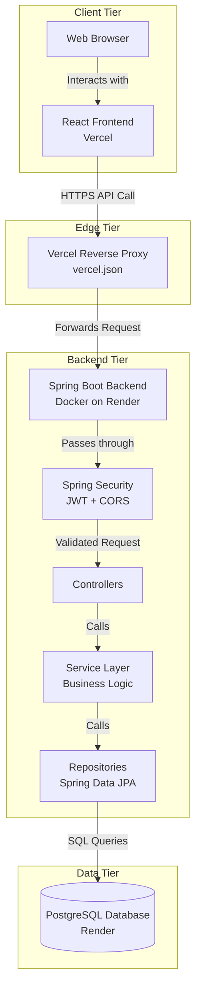

# System Architecture

## 1. Architecture Style
This project utilizes a **Modular Monolith** architecture. A single Spring Boot application contains all the business modules (Auth, Requests, Users), deployed as one Docker container on Render. The React frontend is deployed separately on Vercel.

This was chosen over microservices to reduce network latency, simplify local development, and avoid distributed transaction complexity for a project of this scope.

## 2. Context / Container Diagram
## 2. Context / Container Diagram

## 3. Request Flow (Example: Creating a Request)

In production, the request flow includes a **Vercel Reverse Proxy** to eliminate cross-domain cookie issues:

1. **Frontend (React):** The user submits the "Create Request" form. Axios sends a `POST /api/requests` to `https://visionroot-software-engineering-ass.vercel.app/api/requests`.
2. **Vercel Reverse Proxy (`vercel.json`):** Vercel intercepts the request and forwards it to `https://visionroot-backend.onrender.com/api/requests`. Because the browser sees Vercel as the origin, cookies are treated as **same-origin**.
3. **Security Filter (`JwtAuthenticationFilter`):** The backend reads the `jwt` from the **HttpOnly Cookie**. It validates the token and sets the authenticated User in the `SecurityContext`.
4. **Controller (`ServiceRequestController`):** Receives the request, validates the DTO using `@Valid`, and passes it to the Service.
5. **Service (`ServiceRequestService`):** Applies business logic (sets status to `PENDING`, associates the logged-in User) and calls the Repository.
6. **Repository (`ServiceRequestRepository`):** Persists the Entity to the PostgreSQL database.
7. **Response:** The Service maps the saved Entity to a DTO and returns a `200 OK`. The browser receives the response from Vercel and updates the UI.

## 4. Authentication Architecture (Stateful JWT)

The application uses a **Stateful JWT** architecture to mitigate XSS vulnerabilities:
- **Login:** The backend generates a JWT and sends it in a **`Set-Cookie`** header with `HttpOnly`, `Secure`, and `SameSite` attributes.
- **Session Policy:** The backend uses `SessionCreationPolicy.STATELESS` (no `JSESSIONID` is created). The cookie itself is the session.
- **Request Authentication:** The `JwtAuthenticationFilter` reads the token directly from the cookie on every request.
- **CSRF Protection:** For the live demo, CSRF is disabled to avoid complex cross-domain token synchronization. In production, it would be enabled via `CookieCsrfTokenRepository`. *(Documented in `requirements.md` as a future improvement).*
- **Logout:** The backend sends an expired cookie (`maxAge=0`) to clear the browser state.

## 5. Layer Responsibilities
- **Frontend (React):** Handles UI state, routing, and user experience.
- **Vercel Proxy:** Routes `/api/*` traffic to the Render backend, making the requests same-origin for the browser.
- **Controllers:** Handle HTTP routing, validation, and status codes. No business logic.
- **Services:** The "brain" of the app. Enforces business rules (e.g., status transitions) and coordinates transactions.
- **Repositories:** Handles data access via Spring Data JPA.
- **Database:** PostgreSQL for persistent, relational data storage.

## 6. Environment Configuration

The application uses **Spring Profiles** to handle environment-specific cookie settings:

- **Local (`application.properties`):** `app.cookie.secure=false`, `app.cookie.same-site=Lax` (works on `http://localhost`).
- **Production (`application-prod.properties`):** `app.cookie.secure=true`, `app.cookie.same-site=Lax` (works with the Vercel proxy).

The `SPRING_PROFILES_ACTIVE=prod` environment variable on Render activates the production profile.