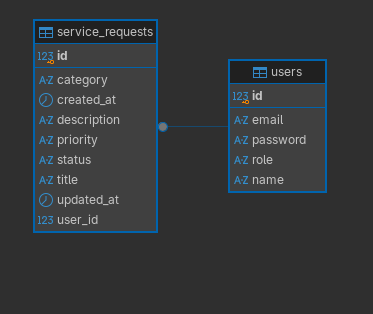

# Data Model

## Entity Relationship Diagram

*Generated directly from the PostgresSQL database using DBeaver.

### 1. User (`users` table)
- `id` (Primary Key, BigInt, Auto-increment)
- `name` (String, Nullable for legacy users)
- `email` (String, Unique, Indexed)
- `password` (String, BCrypt Hashed)
- `role` (Enum: USER, ADMIN)

### 2. ServiceRequest (`service_requests` table)
- `id` (Primary Key, BigInt, Auto-increment)
- `title` (String, Required)
- `description` (Text, Required)
- `category` (String, Required)
- `priority` (Enum: LOW, MEDIUM, HIGH)
- `status` (Enum: PENDING, IN_PROGRESS, RESOLVED, CANCELLED)
- `created_at` (Timestamp, Auto-generated)
- `updated_at` (Timestamp, Auto-updated)
- `user_id` (Foreign Key -> User.id)

## Relationships
- **One-to-Many:** One `User` can have many `ServiceRequests`. The `user_id` foreign key ensures data integrity (a request cannot exist without a valid user).