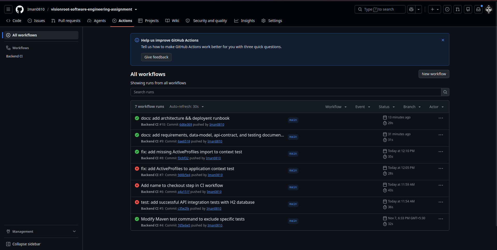
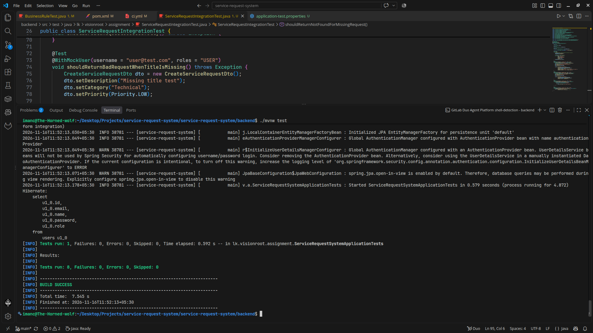
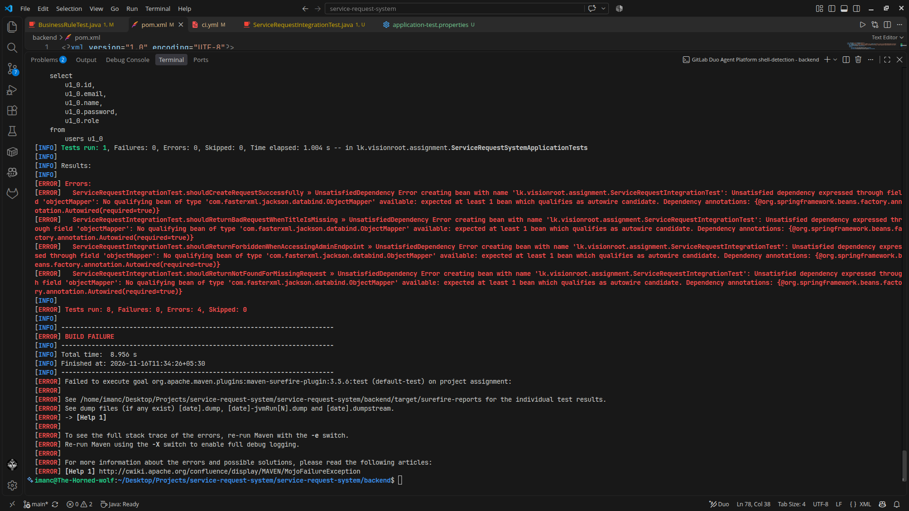

# Daily Evidence Record - Day 01

**Date:** November 16, 2026
**Day / Topic:** Testing, CI/CD Resolution, and Documentation
**Objective:** Finalize the project by adding integration tests, ensuring the CI pipeline passes, and generating all required architecture and API documentation.

## 1. What I Learned
- How to write Integration Tests using `MockMvc` to test HTTP status codes and validation without a live frontend.
- How to configure an H2 in-memory database (`application-test.properties`) specifically for the test environment so tests don't rely on a local PostgreSQL instance.
- How to resolve Foreign Key constraint violations in JUnit `@BeforeEach` setup.
- How to export database ER diagrams directly from DBeaver for documentation.

## 2. What I Implemented
- Created `ServiceRequestIntegrationTest.java` to test API endpoints (Success, Bad Request, Not Found, Forbidden).
- Added H2 dependency to `pom.xml` (test scope).
- Configured GitHub Actions `ci.yml` to run the full test suite automatically.
- Generated comprehensive documentation in the `docs/` folder.

## 3. Files / Folders Changed
- `backend/src/test/java/.../ServiceRequestIntegrationTest.java` (Created)
- `backend/src/test/resources/application-test.properties` (Created)
- `backend/src/test/java/.../ServiceRequestSystemApplicationTests.java` (Added `@ActiveProfiles("test")`)
- `docs/requirements.md`, `docs/architecture.md`, `docs/data-model.md`, `docs/api-contract.md`, `docs/testing.md`, `docs/deployment.md` (Created)

## 4. How I Tested It
Ran the test suite locally using `./mvnw test`. 
**Result:** `Tests run: 8, Failures: 0, Errors: 0, Skipped: 0` (BUILD SUCCESS).

## 5. Evidence Links
- **GitHub Actions CI Success:** 
- **Successful Local Test Run:** 
- **Initial Test Failure (Debugging):** 
- **ER Diagram:** `docs/dbeaver-er-diagram.png`

## 6. Problem Encountered
The integration tests initially failed with an `UnsatisfiedDependencyException` because Spring Boot 4.x no longer auto-configures the `ObjectMapper` bean in the test context.
*(See `local-test-failure.png` for the exact error trace).*

## 7. How I Investigated It
I reviewed the GitHub Actions logs and noticed that the `ServiceRequestSystemApplicationTests` (the default context load test) was trying to connect to a PostgreSQL database. I realized that GitHub's runners do not have a PostgreSQL database running.

## 8. Root Cause
The test class was missing the `@ActiveProfiles("test")` annotation, meaning it was falling back to the default `application.properties` (which points to localhost:5432) instead of the H2 test configuration. Additionally, the ObjectMapper needed to be manually instantiated in the test.

## 9. How I Fixed It
I added `@ActiveProfiles("test")` to the test class. This tells Spring Boot to load the `application-test.properties` file, which uses an in-memory H2 database. I also changed the ObjectMapper instantiation to `private final ObjectMapper objectMapper = new ObjectMapper();`. The CI pipeline then passed successfully.

## 10. What I Would Improve
- Add a Global Exception Handler (`@RestControllerAdvice`) so that custom exceptions (like `BadRequestException`) return clean `400 Bad Request` JSON responses instead of bubbling up as 500 Servlet errors.
- Implement End-to-End (E2E) tests using Playwright to test the React frontend interacting with the backend.

## 11. Git Activity
- **Branch:** `main`
- **Commit Hash:** 6d6e369ada03da3c49940c115c76ad09f6bc41e1
- **Pull Request:** N/A

## 12. Blockers / Questions for Supervisor
- N/A