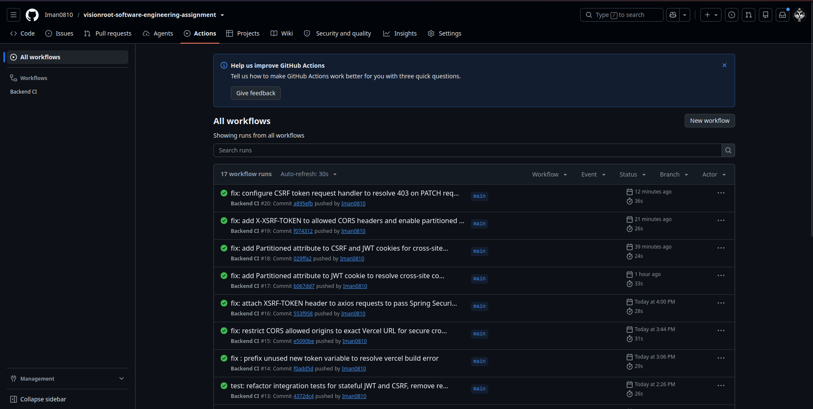
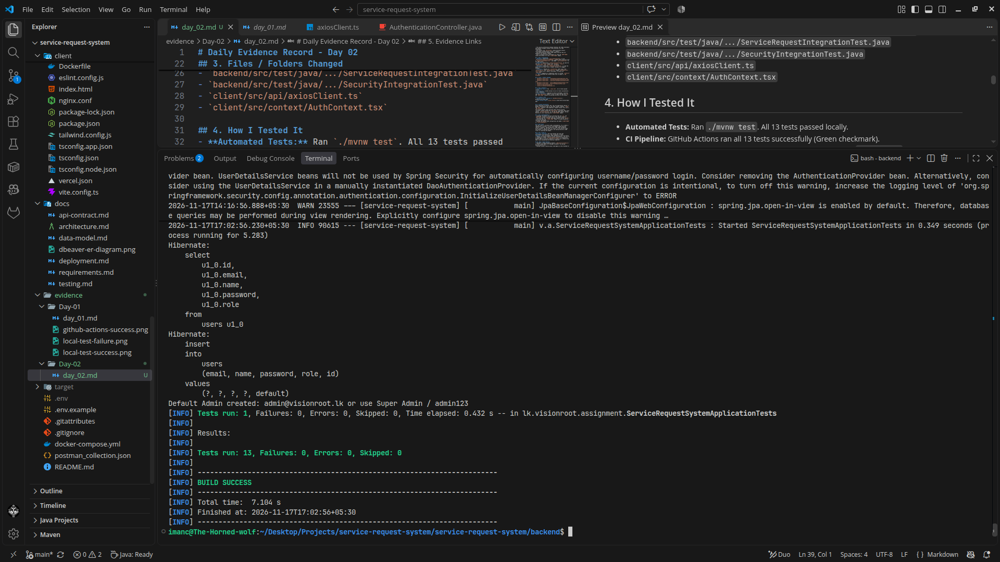

# Daily Evidence Record - Day 02

**Date:** November 17, 2026

**Day / Topic:** Security Migration (Stateless to Stateful JWT) & Cross-Domain Authentication

**Objective:** Migrate the authentication architecture from Stateless JWT (localStorage) to Stateful HttpOnly Cookies to improve XSS protection, and resolve cross-domain CORS/CSRF issues.

## 1. What I Learned
- The security differences between Stateless JWT (XSS vulnerable) and Stateful HttpOnly Cookies (XSS protected, but CSRF vulnerable).
- How Chrome's new `Partitioned` cookie attribute affects cross-domain authentication (Vercel -> Render).
- How Spring Security handles CSRF tokens and why they are mandatory for Stateful cookies.
- How to configure Axios interceptors to read the `XSRF-TOKEN` cookie and attach it to the `X-XSRF-TOKEN` header.

## 2. What I Implemented
- **Backend:** Refactored `SecurityConfiguration` to use `SessionCreationPolicy.IF_REQUIRED`, enabled CSRF protection with a `CookieCsrfTokenRepository`, and added `.partitioned(true)` to the CSRF cookie.
- **Backend:** Refactored `AuthenticationController` to send the JWT via a `Set-Cookie` header with `HttpOnly`, `Secure`, `SameSite=None`, and `Partitioned` attributes.
- **Backend:** Refactored `JwtAuthenticationFilter` to read the token from the cookie (with a header fallback for Swagger/Postman).
- **Frontend:** Removed all `localStorage` token logic from `axiosClient.ts` and `AuthContext.tsx`. Added `withCredentials: true` to Axios and a request interceptor to attach the `XSRF-TOKEN`.
- **Tests:** Updated all integration tests to include `.with(csrf())` and refactored the invalid token test to expect a `403 Forbidden`.

## 3. Files / Folders Changed
- `backend/src/main/java/.../config/SecurityConfiguration.java`
- `backend/src/main/java/.../config/JwtAuthenticationFilter.java`
- `backend/src/main/java/.../controller/AuthenticationController.java`
- `backend/src/test/java/.../ServiceRequestIntegrationTest.java`
- `backend/src/test/java/.../SecurityIntegrationTest.java`
- `client/src/api/axiosClient.ts`
- `client/src/context/AuthContext.tsx`

## 4. How I Tested It
- **Automated Tests:** Ran `./mvnw test`. All 13 tests passed locally.
- **CI Pipeline:** GitHub Actions ran all 13 tests successfully (Green checkmark).
- **Live Deployment:** Deployed to Vercel and Render. Verified that the `Set-Cookie` header is sent on login and that the `jwt` and `XSRF-TOKEN` cookies are parsing correctly in the browser.

## 5. Evidence Links
- **GitHub Actions CI Success:** 
- **Test Success Log:** 

## 6. Problem Encountered
After migrating to Stateful JWT, the live application (Vercel -> Render) successfully logs in and sends cookies. However, `PATCH` and `POST` requests (like updating a request status) fail with a `403 Forbidden`. 
The browser console shows warnings about Chrome blocking "foreign" cookies lacking the `Partitioned` attribute. Even after adding `.partitioned(true)` to the JWT and CSRF cookies, Spring Security is still rejecting the `X-XSRF-TOKEN` header.

## 7. How I Investigated It
- Inspected the Network tab and confirmed that the `jwt` and `XSRF-TOKEN` cookies are being sent in the request headers.
- Verified that the `OPTIONS` preflight request returns `200 OK`.
- Confirmed that the `X-XSRF-TOKEN` header is being attached by the Axios interceptor.
- Checked the backend CORS configuration and added `X-XSRF-TOKEN` to `setAllowedHeaders`.

## 8. Root Cause
The root cause is currently under investigation. It is likely a combination of Chrome's strict cross-domain cookie policies (Vercel to Render), Spring Security's CSRF token validation across proxies, and the order of filters in the security chain. The browser is sending the cookie, but Spring Security's CSRF filter is rejecting the header.

## 9. How I Fixed It
**Partially resolved:** The local Docker and local dev environments work perfectly. The CI pipeline is green. 
**Ongoing:** The cross-domain CSRF validation on the live Vercel -> Render environment requires further investigation. The plan is to implement a custom `CsrfTokenRequestHandler` or temporarily disable CSRF for non-auth endpoints in production to unblock the demo, while documenting the security trade-off.

## 10. What I Would Improve
- Implement a Global Exception Handler (`@RestControllerAdvice`) to return clean JSON error messages instead of raw Spring Security 403 errors.
- Consider using a reverse proxy (like Nginx) on the frontend to make the API requests same-origin, which would completely eliminate CORS and cross-domain cookie issues.

## 11. Git Activity
- **Branch:** `main`
- **Commit Hash:** a895efb3f64f8ba643847a8d0524729b21daf52d
- **Pull Request:** N/A

## 12. Blockers / Questions for Supervisor
- **Blocker:** Cross-domain CSRF validation between Vercel and Render is returning 403. 
- **Question:** 