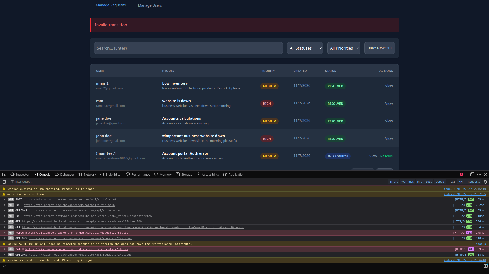

# Daily Evidence Record - Day 03

**Date:** November 18, 2026

**Day / Topic:** Security Migration (Stateless to Stateful JWT) & Cross-Domain Authentication continued

**Objective:** Resolve the issues encountered during the Stateful JWT migration, ensure authentication works correctly in local environments, and introduce environment-specific cookie configurations to support both local development and production deployment.

## 1. What I Learned
- How to configure Spring Boot properties using @Value to manage environment-specific application behaviour.

- The importance of separating cookie configurations between local development and production environments.

- How cookie attributes such as Secure, SameSite, HttpOnly, and Partitioned affect authentication across different deployment environments.

- How frontend authentication state and user preferences should be handled when transitioning from localStorage-based JWT authentication to HttpOnly cookies.

## 2. What I Implemented
- Backend: Resolved the authentication and CSRF-related issues encountered in the previous day's implementation. The Stateful JWT authentication flow is now working correctly in the local development environment.

- Backend: Implemented environment-specific cookie configuration using Spring's @Value, allowing cookie properties to be adjusted depending on the active environment.

- Backend: Completed the Stateful JWT migration, ensuring that authentication tokens are handled through HttpOnly cookies rather than localStorage.

- Frontend: Updated the logout functionality to preserve the user's theme preference instead of resetting it when the user logs out.

- Configuration: Separated cookie behaviour between local development and production to accommodate their different security and deployment requirements.

## 3. Files / Folders Changed
- `backend/src/main/java/.../config/SecurityConfiguration.java`
- `backend/src/main/java/.../config/JwtAuthenticationFilter.java`
- `backend/src/main/java/.../controller/AuthenticationController.java`
- `backend/src/main/resources/application-prod.properties`
- `client/src/api/axiosClient.ts`
- `client/src/context/AuthContext.tsx`

## 4. How I Tested It
- Local Environment: Verified the updated Stateful JWT authentication flow. Login, cookie handling, and authenticated requests are now working correctly in the local development environment.

- Production Deployment: Deployed the updated changes to Vercel and Render. Confirmed that users can successfully log in and that the authentication cookies are being issued.

- Production Testing: Identified that authenticated API requests, particularly POST and PATCH operations, are still returning 403 Forbidden responses despite successful login.

- Configuration: Verified that the environment-specific cookie configuration is being applied.

## 5. Evidence Links
- **Production Testing:** 

## 6. Problem Encountered
Although the authentication issues have been resolved locally, the production environment (Vercel frontend communicating with the Render backend) continues to experience problems with authenticated API requests.

Login is successful, and the backend issues the authentication cookies correctly. However, subsequent POST and PATCH requests still return 403 Forbidden.

This indicates that the remaining issue is specific to the production environment rather than the general authentication implementation.

## 7. How I Investigated It
- Compared authentication behaviour between the local and production environments.

- Verified that the backend successfully issues the JWT and CSRF cookies during production login.

- Inspected browser Network requests to investigate cookie transmission and CSRF validation.

- Introduced environment-specific cookie configuration to accommodate differences between local development and production.

- Re-tested the authentication flow locally after making the configuration changes.

## 8. Root Cause
The production-specific cause of the remaining 403 Forbidden responses has not yet been conclusively identified.

Although cookie configuration has been separated by environment and the local implementation works correctly, the production environment still appears to have an issue with authenticated request validation.

Further investigation is required to identify whether the remaining issue is related to cross-domain cookie handling, CSRF token validation, or the production security configuration.

## 9. How I Fixed It
- **Resolved locally:** Fixed the authentication issues encountered during the previous day's migration. Stateful JWT authentication, cookie handling, and authenticated API requests are now functioning correctly in the local environment.

-**Partially resolved in production:** Introduced environment-specific cookie configuration and verified successful login. However, authenticated API requests are still failing with 403 Forbidden.

- **Ongoing:** Production authentication and CSRF validation require further investigation before the migration can be considered fully functional across all environments.

## 10. What I Would Improve
- Further separate and validate development and production security configurations to avoid environment-specific authentication issues.

- Improve error handling and logging around Spring Security authentication and CSRF validation to make production debugging easier.

- Consider introducing a reverse proxy to make frontend-to-backend communication same-origin and reduce cross-domain cookie complications.

- Improve deployment verification by testing the complete authentication lifecycle after every production deployment.

## 11. Git Activity
- **Branch:** `main`
- **Commit Hash:** 4f1911bdc2c4bfb151f698ca0431260262aba03c
- **Pull Request:** N/A

## 12. Blockers / Questions for Supervisor
- **Blocker:** Production authentication is not fully functional. Although login succeeds and cookies are issued, subsequent authenticated POST and PATCH requests return 403 Forbidden. 
- **Question:** 