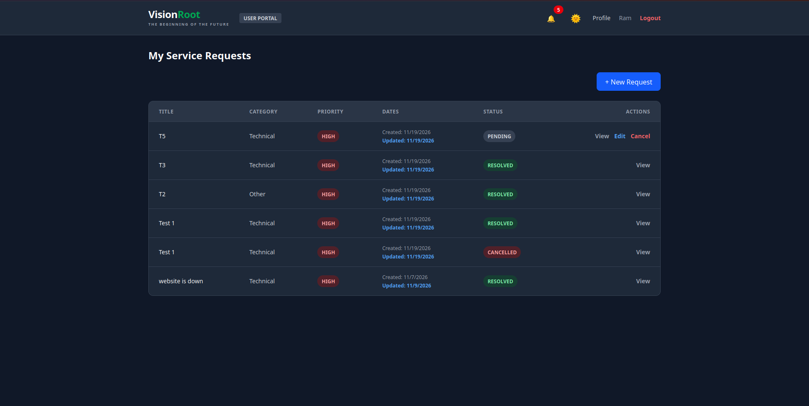

# Daily Evidence Record - Day 04

**Date:** November 19, 2026

**Day / Topic:** Security Migration (Stateless to Stateful JWT), Cross-Domain Authentication & Deployment Fixes

**Objective:** Resolve the remaining production authentication issues, ensure consistent application behaviour across local, hosted, and Dockerized environments, and address frontend usability and role-management improvements.

## 1. What I Learned
- How Vercel proxy rewrites can help resolve cross-domain cookie and authentication issues by routing API requests through the frontend deployment.

- How SameSite cookie configurations can be used to provide additional cookie protection when handling authentication across deployment environments.

- How production build errors can occur due to unused variables and how to identify and resolve them.

- The importance of synchronizing frontend application state after profile updates and role changes.

- How to prevent users from accidentally removing their own administrative privileges through role-management functionality.

## 2. What I Implemented
- Backend / Configuration: Resolved the production cross-domain cookie and CSRF issues by implementing a Vercel proxy rewrite and adjusting the production cookie and CSRF configuration.

- Backend / Security: Disabled CSRF protection for the live demo environment and relied on SameSite cookie protection to accommodate the production deployment requirements.

- Frontend: Fixed a production build error by removing an unused variable that was preventing successful deployment.

- Frontend: Updated the profile functionality to reload the page after profile updates to ensure the navigation bar displays the latest user information.

- Frontend: Added horizontal scrolling to tables to improve usability and accessibility when displaying wider datasets.

- Frontend / Role Management: Implemented self-demotion prevention to prevent administrators from accidentally removing their own administrative privileges.

- Frontend / Role Management: Added success messages to provide feedback when user roles are successfully changed.

## 3. Files / Folders Changed
- `backend/src/main/java/.../config/SecurityConfiguration.java`
- `backend/src/main/resources/application-prod.properties`
- `client/src/api/axiosClient.ts`
- `client/src/context/AuthContext.tsx`
- `client/src/pages/AdminDashboard.tsx`
- `client/src/pages/Profile.tsx`
- `client/src/pages/UserDashboard.tsx`
- `client/src/vercel.json`

## 4. How I Tested It
- Local Environment: Re-ran the automated tests and verified that the application functions correctly after the latest changes.

- Production Deployment: Verified that authentication and authenticated API requests are now functioning correctly on the hosted Vercel and Render deployment.

- Dockerized Environment: Rebuilt and tested the Dockerized application to verify that the updated implementation works correctly.

- Cross-Environment Verification: Confirmed that the application is now functioning correctly across local development, the hosted deployment, and the Dockerized environment.

- Frontend: Verified the updated profile behaviour, role-management functionality, and horizontal table scrolling.

## 5. Evidence Links
- **Sucessful Deployement:** 

## 6. Problem Encountered
- The production deployment continued to experience authentication failures even though login was successful and authentication cookies were being issued correctly.

- Authenticated API requests were returning 403 Forbidden responses due to cross-domain cookie and CSRF validation issues between the Vercel frontend and Render backend.

- Additionally, a production build error caused by an unused variable prevented successful deployment.

## 7. How I Investigated It
- Investigated the production authentication failures by examining the interaction between the Vercel frontend and Render backend.

- Reviewed the existing cookie and CSRF configurations to identify the cause of the cross-domain authentication issues.

- Investigated the possibility of using a Vercel proxy rewrite to route API requests and avoid the existing cross-domain complications.

- Identified and removed the unused variable responsible for the production build error.

- Rebuilt and tested the application after applying the changes.

## 8. Root Cause
The production authentication failures were related to cross-domain cookie handling and CSRF validation between the separately hosted frontend and backend.

The existing configuration was not working reliably with the Vercel-to-Render deployment setup.

The production build failure was caused by an unused variable in the frontend code.

## 9. How I Fixed It
- Resolved: Implemented a Vercel proxy rewrite to address the cross-domain cookie and authentication issues. Adjusted the production security configuration for the live demo by disabling CSRF protection and relying on SameSite cookie settings.

- Resolved: Removed the unused variable responsible for the Vercel production build failure.

- Resolved: Implemented the frontend improvements related to profile updates, role management, and table scrolling.

- Verified: Successfully tested the application across local development, the hosted deployment, and the Dockerized environment. All three environments are now functioning correctly.
## 10. What I Would Improve
- Reconsider the production CSRF configuration before moving beyond the live demo, as disabling CSRF protection introduces a security trade-off.

- Improve automated testing to cover the complete authentication lifecycle across different deployment environments.

- Continue improving frontend usability and feedback for administrative operations.

- Ensure that production and Dockerized configurations remain consistent with the application's security requirements.

## 11. Git Activity
- **Branch:** `main`
- **Commit Hash:** bf103f0c0522a5bbc4113c8fa539130597032f12
- **Pull Request:** N/A

## 12. Blockers / Questions for Supervisor
- **Blocker:** No current deployment blockers. The application is functioning correctly in local, hosted, and Dockerized environments.
- **Question:** 